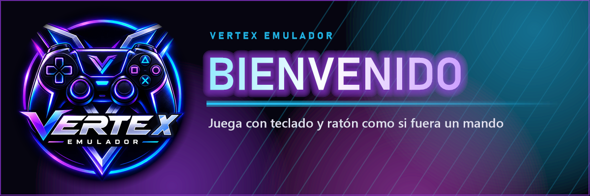

  

# Vertex Emulador

Juega con **teclado y ratón** en los juegos que piden mando. Vertex crea un **mando virtual de Xbox o PlayStation** que Windows y los juegos reconocen, y lo mueve con tu teclado y tu ratón.

## ⬇️ Descargar

**[Descargar la última versión](https://github.com/Abnaris/vertex-emulador/releases/latest)** → en "Assets", pulsa `VertexEmulador-Instalar-….exe`.

1. **Antes de instalar, apaga la Integridad de memoria:** abre **Seguridad de Windows → Seguridad del dispositivo → Detalles de aislamiento del núcleo** y pon **Integridad de memoria** en **Desactivado**. Reinicia la PC.
   Sin este paso Windows no deja instalar Interception y el juego también verá tu ratón.
2. Abre el instalador y acepta los términos.
3. Windows pedirá permiso de administrador para instalar los controladores: pulsa **Sí**.
4. Cuando termine, **reinicia** la PC.
5. Abre **Vertex Emulador**: tienes **3 días de prueba gratis**.

¿Sale "Windows protegió su PC"? Pulsa **Más información → Ejecutar de todas formas**. Pasa con los programas nuevos que Windows aún no conoce.

## 💻 Requisitos

- Windows 10 u 11 de 64 bits
- El instalador pone dos controladores: **ViGEmBus** (el mando virtual) e **Interception** (para que el juego solo vea el mando)

## 🛒 Licencias y soporte

Las licencias se compran y el soporte se da **solo** en el servidor oficial de Discord:
**https://discord.gg/xzA2KBBaVW**

🔒 Nadie de Vertex te escribirá primero por privado. Descarga Vertex solo desde esta página o desde el canal #descargar del Discord.

---

Este repositorio solo contiene las descargas. Vertex Emulador no está afiliado a Microsoft, Sony ni a ningún juego. Al instalarlo aceptas los [términos de uso](TERMINOS-DE-USO.txt) y el [aviso de privacidad](PRIVACIDAD.txt).
